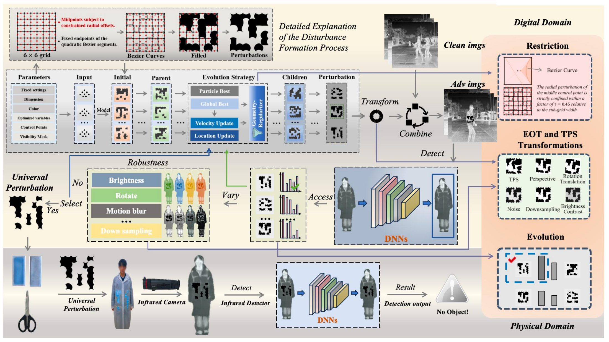
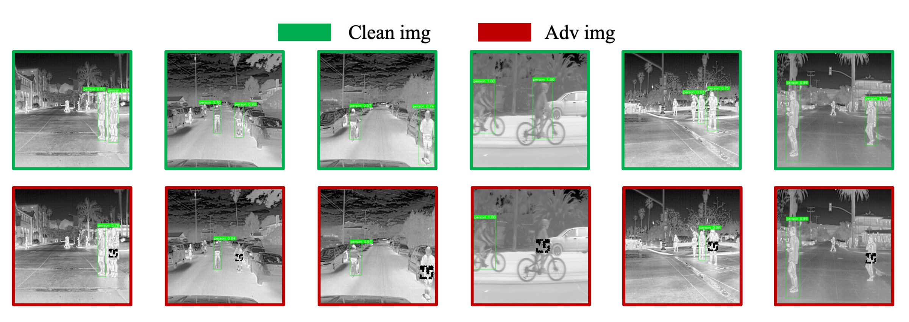
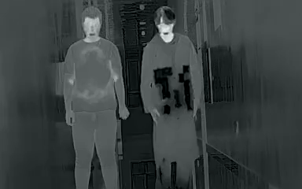

<div align="center">

# UPPA: Universal Physical Patch Attack

### Thermal Topology Collapse: Universal Physical Patch Attacks on Infrared Vision Systems

[Overview](#overview) · [Digital Examples](#digital-examples) · [Physical Demo](#physical-demo-on-yolov3) · [Installation](#installation) · [Quick Start](#quick-start)

</div>

<p align="center">
  
</p>
<p align="center">
  <em>Overview of UPPA. A shared Bézier Curved-Block pattern is optimized and reused across infrared pedestrian images.</em>
</p>

## Overview

UPPA learns a universal patch for infrared pedestrian detection using **topology-constrained Bézier Curved-Blocks** and **Particle Swarm Optimization (PSO)**. The patch geometry combines smooth quadratic boundaries with fixed endpoints, axial locking, and bounded control-point offsets.

This repository provides digital patch optimization, evaluation, and adversarial image generation. The framework figure illustrates the broader manuscript method; TPS/EOT and physical experiment pipelines are outside the current code release.

## Highlights

- **Universal patch:** one shared parameter vector is applied across the selected image set.
- **Curved-Block geometry:** quadratic Bézier edges and a visibility mask control the patch shape.
- **Topology constraints:** fixed grid endpoints, axial locking, and normal offsets bounded by `0.45 × grid spacing`.
- **Black-box optimization:** PSO uses detector confidence as fitness feedback.
- **Configurable runs:** command-line paths and settings, with patch images, parameter vectors, and attack examples saved to disk.

## Digital Examples

<p align="center">
  
</p>
<p align="center">
  <em>Digital examples generated by UPPA. Top: clean images (green borders). Bottom: corresponding patched images (red borders).</em>
</p>

## Physical Demo on YOLOv3

<p align="center">
  <a href="https://github.com/yk-up/UPPA/raw/refs/heads/main/assets/yolov3_physical_demo.mp4">
    
  </a>
</p>
<p align="center">
  <em>Physical experiment against YOLOv3. The animation previews the first six seconds of the full recording.</em>
</p>

[**Download the full video (MP4, 25 seconds)**](https://github.com/yk-up/UPPA/raw/refs/heads/main/assets/yolov3_physical_demo.mp4)

## Repository Layout

```text
UPPA/
├── assets/
│   ├── method_overview.png    # Method overview
│   ├── digital_examples.png   # Digital attack examples
│   ├── yolov3_physical_demo.mp4    # YOLOv3 physical experiment video
│   └── yolov3_physical_preview.gif # Animated preview
├── configs/
│   └── models.json            # Detector configuration and checkpoint paths
├── uppa/
│   ├── geometry.py            # Bézier renderer and geometry constraints
│   ├── fitness.py             # Detection fitness
│   ├── pso.py                 # Particle swarm optimizer
│   ├── engine.py              # Attack orchestration
│   ├── cli.py                 # Configuration and main workflow
│   └── utils.py               # Console/file logging
├── UPPA.py                    # Command entry point
├── requirements.txt
└── README.md
```

## Installation

The reference AutoDL environment uses the following versions:

| Component | Version |
| --- | --- |
| Python | 3.8.10 |
| PyTorch / torchvision | 1.10.0+cu113 / 0.11.1+cu113 |
| PyTorch CUDA build | 11.3 |
| MMCV-full / MMDetection | 1.6.1 / 2.25.1 |
| NumPy / OpenCV | 1.21.4 / 4.6.0.66 |

[requirements.txt](requirements.txt) contains the recorded package versions. CUDA-tagged PyTorch and MMCV-full need compatible binary distributions; this inventory has not been validated as a clean-install recipe.

Create a Python environment:

```bash
conda create -n uppa python=3.8.10 -y
conda activate uppa
```

Install the matching CUDA 11.3 builds of PyTorch and torchvision, together with MMCV-full 1.6.1, using the official [PyTorch](https://pytorch.org/get-started/previous-versions/) and [MMCV](https://mmcv.readthedocs.io/en/v1.6.1/get_started/installation.html) installation instructions. Once these binary packages are available, install the remaining dependencies:

```bash
python -m pip install -r requirements.txt
```

Run the commands below from the repository root.

## Data and Models

Prepare:

- Infrared images in a directory containing `.png`, `.jpg`, or `.jpeg` files.
- An MMDetection 2.x detector configuration.
- A matching detector checkpoint fine-tuned for infrared pedestrian detection.

Edit `configs/models.json` to point to your files:

```json
[
  {
    "name": "yolov3",
    "config": "./configs/configs/yolov3.py",
    "checkpoint": "./weights/my_custom_dataset/yolov3_909.pth"
  }
]
```

The experiments use detector weights fine-tuned for infrared pedestrian detection. Set each model's `config` and `checkpoint` paths in `configs/models.json` to its matching configuration and fine-tuned weights.

The model list includes YOLOv3, DETR, Mask R-CNN, Faster R-CNN, Libra R-CNN, RetinaNet, YOLOF, YOLOX, and Deformable DETR. Detector configs, weights, and datasets are **not included**.

All relative paths, including those inside the JSON configuration, resolve from the current working directory. The code assumes the person class has index `0`.

## Quick Start

Check that your input paths exist without loading a detector:

```bash
python UPPA.py \
  --config configs/models.json \
  --images /path/to/images \
  --model yolov3 \
  --check
```

Run patch optimization and evaluation:

```bash
python UPPA.py \
  --config configs/models.json \
  --images /path/to/images \
  --output attack_results \
  --model yolov3 \
  --device cuda:0
```

Select multiple models with `--model yolov3 detr`, or omit `--model` to process every configured model. Each detector is used to optimize its own shared patch.

### Default Settings

| Parameter | Value |
| --- | --- |
| Grid dimension | 6 |
| Particles | 50 |
| Iterations | 10 |
| PSO inertia `w` | 0.9 |
| PSO coefficients `c1`, `c2` | 1.6, 1.4 |
| Fixed scalars `r1`, `r2` | 0.5, 0.5 |
| Velocity bound | 0.1 |
| Patch color | Black |
| Nominal square patch side | 1/4 of target bbox height, capped by bbox width |

The grid dimension, particle count, and iteration count follow the manuscript settings. For a quick run with a smaller grid and search budget:

```bash
python UPPA.py \
  --images /path/to/images \
  --model yolov3 \
  --grid-dimension 2 \
  --particles 3 \
  --iterations 2 \
  --output attack_results_quick
```

## Outputs

```text
attack_results/
├── uppa_<timestamp>.log
├── <model>_universal_patch.png
├── <model>_bezier_params.npy
└── attacked/<model>/
    ├── success/
    └── failed/
```

An existing patch or parameter file causes an error; choose a new output directory for a new run.

## Evaluation Protocol

The script selects images containing exactly one person detection with confidence **above 0.5** on the clean image. Fitness is the mean of `1 - maximum person confidence`. An attack succeeds when no person box is returned or the maximum person confidence falls below `0.5`.

Optimization and final evaluation use the same selected images. The reported ASR is therefore an evaluation on the optimization image set. The code prints per-model ASR and an average over processed models.

## Responsible Use

This code is provided for robustness auditing and academic research on infrared pedestrian detection systems. Do not use it to attack systems without authorization.
